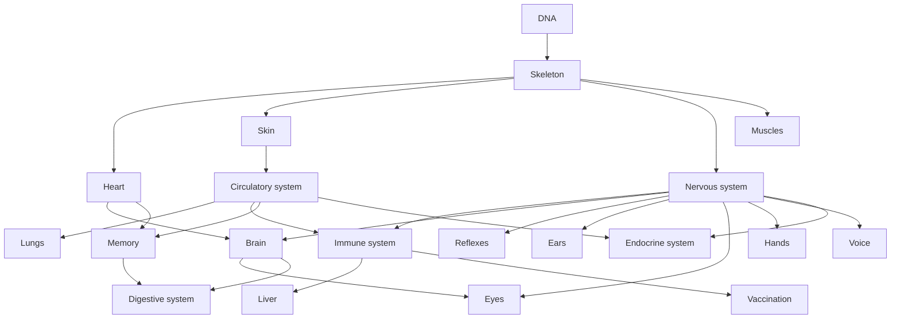

# Aureon as an organism

Aureon's 53 capabilities (fused from all 790 projects) are grouped into 20 organs. Like a body, each organ
needs others to work: the immune system must see the blood (traffic) and report through the nerves; the
brain needs nerves to hear anything; reflexes act on their own before the brain answers.

`python -m aureon body` shows live vitals; `python -m aureon body --fail <organ>` shows the cascade.

| Organ | Body analogy | Job in Aureon | Needs | If it fails, these suffer | Capabilities | Projects |
|---|---|---|---|---|---|---|
| **DNA** | Genome that builds identical bodies | Reproducible images and provisioning: rebuild a lost device identically | - | Skeleton, Heart, Skin, Circulatory system, Lungs, Immune system, Liver, Vaccination, Nervous system, Brain, Reflexes, Ears, Eyes, Hands, Voice, Memory, Endocrine system, Muscles, Digestive system | `system.image` | 31 |
| **Skeleton** | Frame everything hangs on | Firmware, secure boot, base OS and appliance personalities | DNA | Heart, Skin, Circulatory system, Lungs, Immune system, Liver, Vaccination, Nervous system, Brain, Reflexes, Ears, Eyes, Hands, Voice, Memory, Endocrine system, Muscles, Digestive system | `system.firmware` `system.appliance` `system.research-os` | 91 |
| **Heart** | Pumps blood to every organ | Container/VM runtime that keeps every service alive and restarts it | Skeleton | Brain, Eyes, Memory, Digestive system | `perform.compute` | 24 |
| **Skin** | Barrier that keeps germs out | Filtered DNS and firewall: most threats never get in | Skeleton | Circulatory system, Lungs, Immune system, Liver, Vaccination, Memory, Endocrine system, Digestive system | `network.dns` | 6 |
| **Circulatory system** | Carries oxygen between organs | Encrypted VPN and mesh that carry traffic between phone, laptop and Node | Skin | Lungs, Immune system, Liver, Vaccination, Memory, Endocrine system, Digestive system | `network.vpn` `network.access` | 20 |
| **Lungs** | Exchange with the outside air | Controlled contact with the outside world: anonymity, tunnels, sync and transfer | Circulatory system | - | `network.anonymity` `network.storage` `network.crypto-nodes` | 20 |
| **Immune system** | Finds and kills infections | IDS/IPS, endpoint protection, tripwires, phone forensics, secret hygiene | Circulatory system, Nervous system | Liver, Vaccination | `protect.network-ids` `protect.endpoint` `protect.deception` `protect.mobile` `protect.secrets` | 23 |
| **Liver** | Breaks down toxins after they get in | Forensics and reverse engineering: take apart what got through | Immune system | - | `protect.forensics` | 9 |
| **Vaccination** | Controlled exposure that builds immunity | Authorized self-audit: attack your own devices so the immune system learns | Immune system | - | `protect.audit` `protect.wifi-audit` `protect.physical` `protect.osint` | 82 |
| **Nervous system** | Carries signals to the brain | Metrics, logs and alerts flowing from every sensor (Netdata, Prometheus, dashboards) | Skeleton | Immune system, Liver, Vaccination, Brain, Reflexes, Ears, Eyes, Hands, Voice, Endocrine system, Digestive system | `perform.observe` `freedom.dashboard` | 15 |
| **Brain** | Understands and decides | Local LLM: the security analyst and the private assistant | Heart, Nervous system | Eyes, Digestive system | `intel.llm` `intel.accel` | 23 |
| **Reflexes** | Spinal cord acts before the brain does | Instant reactions with no AI in the loop: Key panic/tamper lock, HID injection guard | Nervous system | - | `hardware.key` | 30 |
| **Ears** | Hear what is around you | Radio senses: SDR, rogue WiFi and fake cell-tower watch, voice input | Nervous system | - | `radio.sdr` `protect.wireless-watch` `intel.voice` `radio.aviation-space` | 64 |
| **Eyes** | See what is around you | Cameras and vision: presence detection, NVR | Nervous system, Brain | - | `hardware.camera` `intel.vision` | 15 |
| **Hands** | Act on the physical world | GPIO/sensors, remote control and below-OS rescue (PiKVM) | Nervous system | - | `hardware.io` `freedom.remote` `intel.robotics` `make.fabrication` `make.astro` | 113 |
| **Voice** | Speak to others | Own communications plus off-grid LoRa mesh when the network is gone | Nervous system | - | `freedom.comms` `network.offgrid` `radio.ham` | 25 |
| **Memory** | Remembers everything | Personal cloud, databases and web serving: your data on your hardware | Heart, Circulatory system | Digestive system | `freedom.cloud` `freedom.data` `freedom.web` `freedom.business` `freedom.dev` | 37 |
| **Endocrine system** | Slow hormones that tune the whole body | Home automation: schedules and presence that adjust everything else | Nervous system, Circulatory system | - | `home.automation` | 30 |
| **Muscles** | Do the physical work fast | Performance: run any software, light desktop, streaming to the phone | Skeleton | - | `perform.compat` `perform.desktop` `perform.stream` | 36 |
| **Digestive system** | Turns food into energy | Offline knowledge, learning and media feed the user and the brain | Memory, Brain | - | `system.knowledge` `learn.code` `media.center` `media.play` | 96 |
